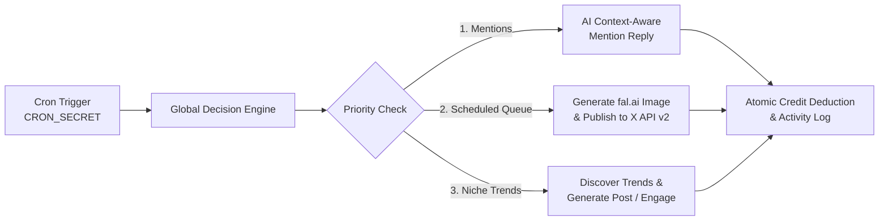

# XUPFLY — Open-Source Autonomous X (Twitter) AI Growth Engine

<p align="center">
  <strong>Self-hosted, multi-account AI automation platform for X (Twitter) built with Next.js, Drizzle ORM, and PostgreSQL.</strong><br/>
  Automate trend discovery, AI tweet & thread generation, fal.ai Flux visuals, context-aware mention replies, smart scheduling, and credit-based multi-tenant management.
</p>

<p align="center">
  
  
  
  
  
</p>

---

## What is XUPFLY?

**XUPFLY** is an open-source, self-hosted **autonomous X (Twitter) growth & content engine**. It combines a multi-provider AI SDK (**Google Gemini, OpenAI, Anthropic Claude**) with **fal.ai** image generation and the official **X API v2 (OAuth 2.0 PKCE)** to research niche trends, draft tweets/threads, reply to mentions, and publish on your preferred schedule — all from a clean SaaS-ready dashboard.

### Autonomous Decision Pipeline



---

## Key Features

- **Autonomous Decision Engine**: Evaluates mentions, queued posts, and niche trends each cycle using a strict anti-spam **one-action-per-run** policy.
- **Multi-Provider AI Writing**: Powered by the Vercel AI SDK (`ai`) with pluggable support for **Google Gemini**, **OpenAI**, and **Anthropic Claude**.
- **AI Visual Generation (`fal.ai`)**: Automatically generates high-resolution contextual images right before publishing.
- **Official X API v2 OAuth 2.0 (PKCE)**: Connect and manage multiple X accounts per user with encrypted HTTP-only OAuth state/PKCE cookies and automatic token refresh.
- **Context-Aware Active Hours**: Schedule publishing and engagement strictly within each account's configured active hours.
- **Multi-Tenant Credit System & Admin Panel**: Built-in NextAuth v5 authentication, role-based access (`admin` / `customer`), atomic credit transactions, configurable per-action credit costs, and user management.
- **Real-Time Activity Logs & Notifications**: Track every generated post, reply, credit deduction, and engine decision in the dashboard.

---

## Tech Stack

| Layer | Technology |
| :--- | :--- |
| **Framework** | Next.js 16 (App Router), React 19, TypeScript |
| **Database & ORM** | PostgreSQL, Drizzle ORM (`drizzle-orm`, `postgres`) |
| **Authentication** | NextAuth.js v5 (`next-auth`) + `bcryptjs` + Zod validation |
| **AI & Media** | Vercel AI SDK (`@ai-sdk/google`, `@ai-sdk/openai`, `@ai-sdk/anthropic`), `@fal-ai/client` |
| **X Integration** | `twitter-api-v2` (OAuth 2.0 PKCE) |
| **UI** | Tailwind CSS v4, shadcn/ui, Lucide Icons, Sonner |

---

## Quick Start

### 1. Prerequisites
- **Node.js** 20+
- **PostgreSQL** 14+
- **X Developer Account** (OAuth 2.0 with Read & Write permissions)

### 2. Clone & Configure
```bash
git clone https://github.com/enveryurtsever/xupfly.git
cd xupfly
cp .env.example .env.local
```
Edit `.env.local` and set your PostgreSQL credentials, `NEXTAUTH_SECRET`, `CRON_SECRET`, X OAuth keys, and AI provider keys.

### 3. Install, Push Schema & Seed
```bash
npm install
npm run db:push
npm run db:seed
npm run dev
```
Open `http://localhost:3003` in your browser.

---

## Cron Automation

Trigger the autonomous engine on a schedule (e.g. every 15 minutes via system cron, GitHub Actions, or your hosting panel) using the `CRON_SECRET` header:

```bash
curl -H "x-cron-secret: YOUR_CRON_SECRET" https://your-domain.com/api/cron/engine
```

Available cron endpoints (all protected by `CRON_SECRET`):
- `GET /api/cron/engine` — Full hierarchical decision engine cycle
- `GET /api/cron/publish` — Publish scheduled posts due now
- `GET /api/cron/mentions` — Check and reply to new mentions
- `GET /api/cron/generate` — Batch AI post generation
- `GET /api/cron/search` — Trend & niche search worker

---

## Security

- All `/api/cron/*` endpoints fail closed unless `CRON_SECRET` is configured and verified via constant-time comparison.
- Post publishing (`POST /api/posts/publish`) enforces per-user post ownership (`xAccounts.ownerId`) to prevent cross-account access.
- Admin routes (`/admin`, `/api/admin/*`) enforce `role === "admin"`.
- See [SECURITY.md](SECURITY.md) for vulnerability reporting and deployment hardening.

## Contributing

Contributions are welcome! Please read [CONTRIBUTING.md](CONTRIBUTING.md) before opening a pull request.

## License

Released under the [MIT License](LICENSE). Ensure you comply with the X Developer Agreement and Terms of Service of all integrated AI providers.
